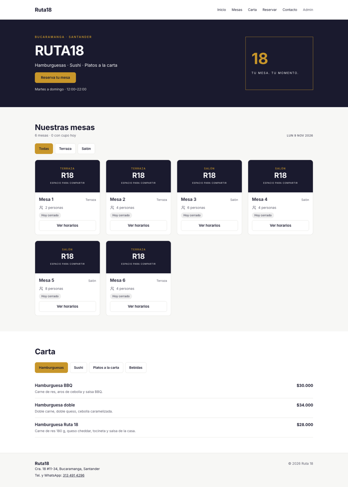
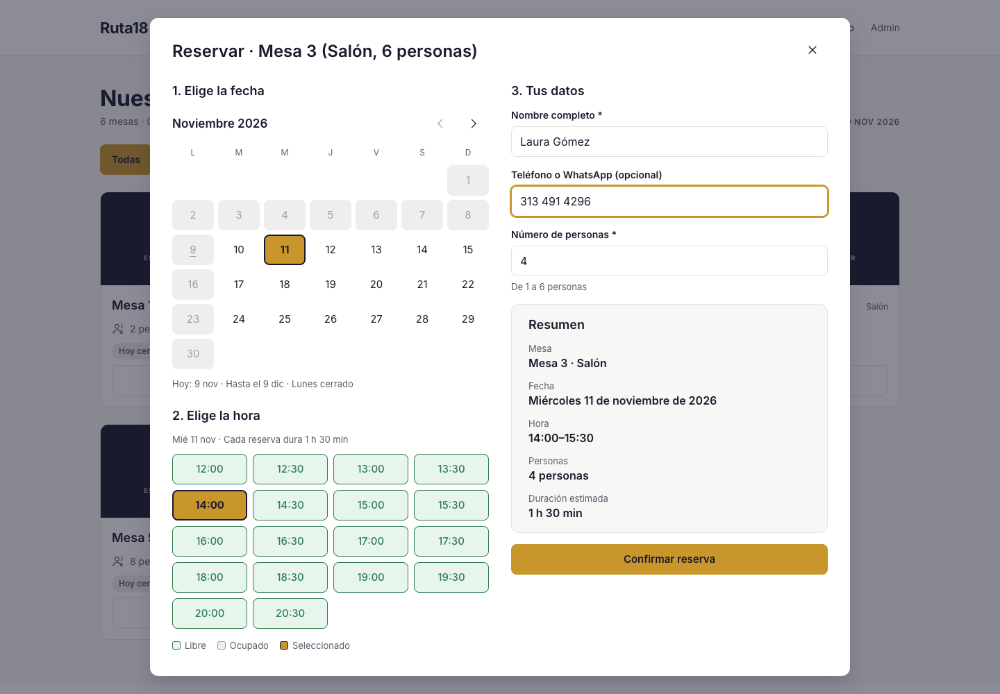
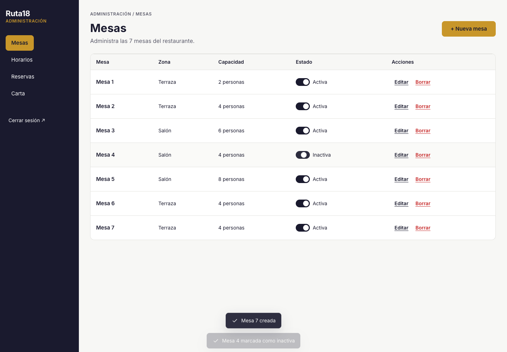

# Ruta 18 · Sistema de Reservas de Mesas

Parcial No 3 de Programación Web, Uniciencia. Docente: Carlos Carrascal.
Autor: Mauricio Murillo Benítez.

## El problema

Ruta 18 es un restaurante de hamburguesas, sushi y platos a la carta en la Cra. 18 #11-34, Bucaramanga (Santander). Hoy recibe reservas por teléfono, WhatsApp o en persona. Eso causa reservas dobles, esperas largas, clientes perdidos y ningún historial.

## La solución

Una aplicación web donde el cliente reserva una mesa por su cuenta y ve la disponibilidad en tiempo real, y el administrador gestiona mesas, horarios, reservas y carta desde un panel protegido.

## Enlaces

| Recurso | Enlace |
|---|---|
| Aplicación en Vercel | https://ruta18-reservas-app.vercel.app · panel en [/admin](https://ruta18-reservas-app.vercel.app/admin) |
| Repositorio | https://github.com/mmurillob2021/ruta18-reservas-app |
| Video de demostración | _Pendiente_ |
| Archivo de Figma | [Diseño](https://www.figma.com/design/cuSkj1NPd49957RoBRP3CU/ruta18_Mesas) · [Prototipo navegable](https://www.figma.com/proto/cuSkj1NPd49957RoBRP3CU/ruta18_Mesas?node-id=3-36551&scaling=min-zoom&content-scaling=fixed&page-id=0%3A1) |
| Documento de proyecto | [docs/Ruta18_Documento_Proyecto_Mauricio_Murillo.docx](docs/Ruta18_Documento_Proyecto_Mauricio_Murillo.docx) |
| Mockups de baja fidelidad | [docs/mockups/](docs/mockups/) |
| Resultados de pruebas | [docs/evidencias/fase5-plan-de-pruebas.md](docs/evidencias/fase5-plan-de-pruebas.md) |

## Capturas

| Inicio | Reserva | Panel |
|---|---|---|
|  |  |  |

## Tecnologías

- HTML5, CSS3 y JavaScript ES6+ con módulos ES, sin frameworks ni bundlers.
- [Supabase](https://supabase.com): PostgreSQL, API REST, Auth y RLS. Cliente `@supabase/supabase-js` por CDN.
- [Vercel](https://vercel.com) para el despliegue desde GitHub.
- Pruebas con `node --test`.

## Cómo ejecutar en local

Requisitos: Node.js 20.6 o superior.

```bash
cp .env.example .env      # llenar SUPABASE_URL y SUPABASE_ANON_KEY
npm run dev               # genera dist/ y lo sirve con serve
npm test                  # pruebas de la lógica pura
```

## Cómo configurar Supabase

1. Crear un proyecto en supabase.com (región São Paulo).
2. En SQL Editor, ejecutar `supabase/schema.sql` y luego `supabase/seed.sql`.
   Para comprobar la base, ejecutar `supabase/pruebas.sql`: los 16 casos deben decir PASA (incluida la doble reserva rechazada con `SLOT_OCUPADO`). El script borra sus reservas de prueba al terminar.
3. Authentication, Providers, Email: desactivar "Allow new users to sign up".
4. Authentication, Users, Add user: el correo de `ADMIN_EMAIL` en `js/config.js`, una contraseña de 12 caracteres o más y "Auto Confirm User".
5. Project Settings, API: copiar Project URL y la clave anon public a `.env` y a las variables de entorno de Vercel.

## Despliegue en Vercel

1. Proyecto `ruta18-reservas-app` con el preset Other. `vercel.json` define el build (`npm run build`), la carpeta `dist`, las URL limpias (`/admin`) y las cabeceras de seguridad.
2. Environment Variables (Production y Preview): `SUPABASE_URL` y `SUPABASE_ANON_KEY`.
3. Cada push a `main` despliega. También se puede desplegar con `vercel deploy --prod`.

## Estructura de carpetas

```
ruta18-reservas-app/
|-- index.html              # Página principal (cliente)
|-- admin.html              # Panel de administración
|-- css/styles.css          # Variables, componentes y responsive
|-- js/
|   |-- config.js           # Constantes del negocio
|   |-- env.js              # Generado al construir (no se sube)
|   |-- supabase.js         # Cliente y funciones de datos
|   |-- logica.js           # Funciones puras: franjas, validación, formatos
|   |-- ui.js               # Modal, avisos y diálogo de confirmación
|   |-- cliente.js          # Módulo cliente
|   |-- admin.js            # Módulo administrador
|-- assets/img/             # Logo, hero e imagen de respaldo
|-- supabase/               # schema.sql, seed.sql y pruebas.sql
|-- scripts/build.mjs       # Copia el sitio a dist/ y genera dist/js/env.js
|-- tests/logica.test.js    # Pruebas automáticas
|-- docs/                   # Documento, mockups y evidencias
```

## Requisitos

| Código | Requisito | Estado |
|---|---|---|
| RF-01 | Visualización de mesas disponibles | Implementado y probado |
| RF-02 | Selección de mesa | Implementado y probado |
| RF-03 | Elección de fecha | Implementado y probado |
| RF-04 | Visualización de horarios disponibles | Implementado y probado |
| RF-05 | Reserva de mesa | Implementado y probado |
| RF-06 | Confirmación de reserva | Implementado y probado |
| RF-07 | Consulta de la carta digital | Implementado y probado |
| RF-08 | Acceso al panel | Implementado y probado |
| RF-09 | Registro de mesas | Implementado y probado |
| RF-10 | Listado de mesas | Implementado y probado |
| RF-11 | Gestión de horarios | Implementado y probado |
| RF-12 | Visualización de reservas | Implementado y probado |
| RF-13 | Cambio de estado de mesa | Implementado y probado |
| RF-14 | Gestión de la carta | Implementado y probado |
| RNF-01 | Usabilidad: reservar en 3 pasos dentro de un solo modal | Implementado |
| RNF-02 | Responsividad: 375, 768 y 1440 px sin scroll horizontal | Probado |
| RNF-03 | Rendimiento: Lighthouse móvil 94 | Probado |
| RNF-04 | Disponibilidad: Vercel y Supabase | Pendiente del despliegue |
| RNF-05 | Seguridad: RLS, Supabase Auth, CSP, `textContent` | Probado |
| RNF-06 | Mantenibilidad: lógica pura separada del DOM | Implementado |
| RNF-07 | Compatibilidad: solo APIs estándar | Probado en Chrome, falta Firefox o Safari |
| RNF-08 | Escalabilidad: zonas y categorías en `js/config.js` | Implementado |
| RNF-09 | Trazabilidad: commits en fechas distintas | En curso |

## Plan de pruebas

- Automáticas: `npm test` sobre `js/logica.js` (27 pruebas, todas pasan).
- Base de datos: `supabase/pruebas.sql` en el SQL Editor (16 casos: doble reserva, validaciones de `crear_reserva` y permisos del rol anon).
- Navegador: casos CP-01 a CP-20 del documento. 19 pasan y CP-20 queda pendiente de probar en un segundo navegador. Resultados y capturas en [docs/evidencias/](docs/evidencias/fase5-plan-de-pruebas.md).
- Lighthouse móvil: rendimiento 94, accesibilidad 100, buenas prácticas 100, SEO 100.

## Pendientes del autor

- Logo e imagen del hero propios en `assets/img/` (hoy se usa el sello "18" del diseño de Figma).
- Carta real con precios en lugar de los platos de ejemplo de `supabase/seed.sql`.
- Instagram y Facebook en `js/config.js` (el pie los oculta mientras estén vacíos) y confirmar el teléfono.
- Video de demostración.

## Nota de seguridad

La clave anon de Supabase es pública por diseño y llega al navegador. Lo que protege los datos son las reglas RLS: el público solo lee mesas activas, horarios activos y platos disponibles, y crea reservas mediante la función `crear_reserva`. Las escrituras de administración exigen una sesión de Supabase Auth. Las variables de entorno evitan que la URL y la clave queden en el historial de GitHub.

## Autor y créditos

Mauricio Murillo Benítez, Uniciencia, 2026.
